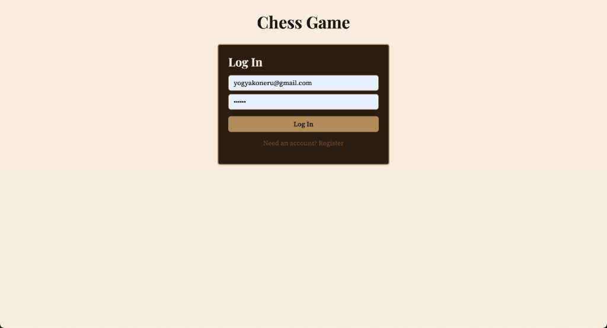
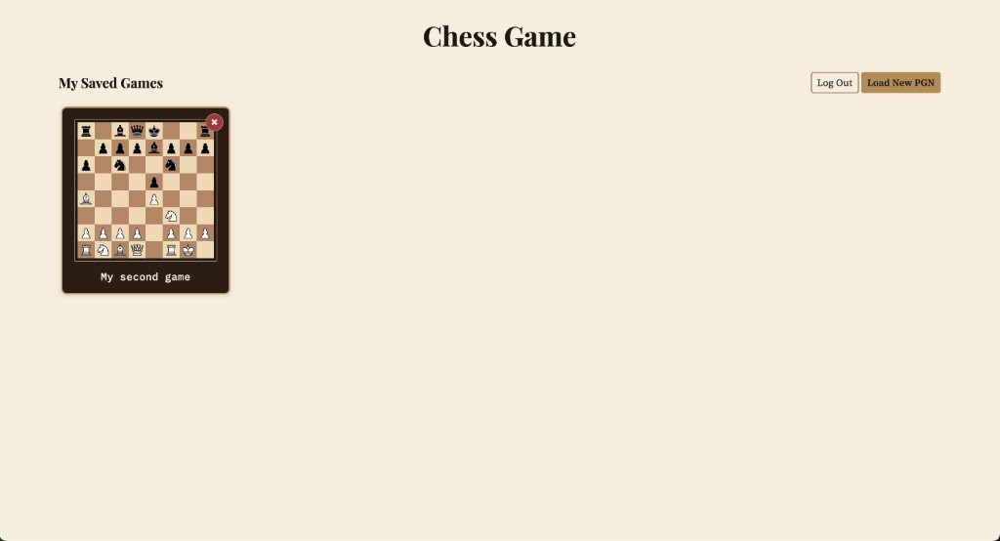
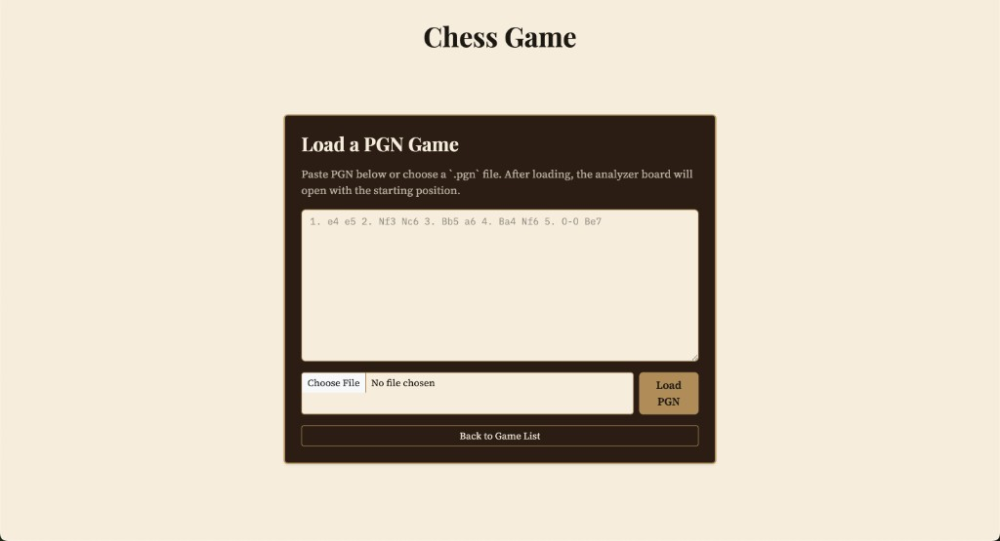
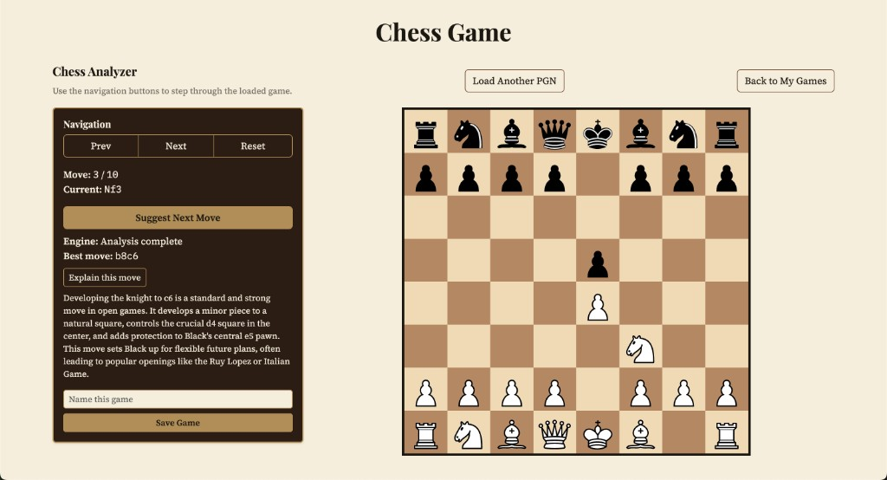

# Chess Analyzer

Full-stack chess app: log in, load a PGN, step through the game, get Stockfish
move suggestions and Gemini explanations, and save games to your account.

Built with a static frontend, a Node/Express API, MariaDB, and nginx — all run
together with Docker Compose.

## Screenshots

### Log in / register



### Saved games

After login you land on your game list. Click a card to open it, or delete it
with the red X.



### Load a PGN

Paste a PGN or upload a `.pgn` file to start analyzing.



### Analyzer

Step through moves, ask Stockfish for the best move, then get a short Gemini
explanation. You can also save the game from here.



## Stack

| Piece | Tech |
|-------|------|
| Frontend | HTML / CSS / JS (`frontend/public`) |
| Chess rules | [chess.js](https://github.com/jhlywa/chess.js) |
| Engine | Stockfish (WebAssembly, in the browser) |
| Explanations | Google Gemini (via the API) |
| API | Node.js + Express (`api/`) |
| Auth | JWT in an httpOnly cookie |
| Database | MariaDB |
| Proxy | nginx |

## Run locally

```bash
cp .env.example .env
# put real values in .env (DB passwords, API_SECRET_KEY, GEMINI_API_KEY)

docker compose up --build
```

Open [http://localhost:8080](http://localhost:8080).

`compose.override.yml` is merged automatically and turns on nodemon + volume
mounts for the API while you're developing.

### Run without the local override

```bash
docker compose -f compose.yml up --build
```

This skips the live mounts and runs the API with `npm run start:prod`.

## Project layout

```
frontend/public/   # UI, Stockfish, piece SVGs
api/               # Express routes, auth, DB access
database/db_schema # SQL init scripts
proxy/             # nginx config
docs/screenshots/  # README images
```

## Secrets

Don't commit `.env` — it's gitignored. Copy from `.env.example`.

If you deploy somewhere, set `MYSQL_*`, `DB_*`, `API_SECRET_KEY`, and
`GEMINI_API_KEY` as env vars / secrets there. For a cloud database, point
`DB_HOST` at that hostname instead of `database`.

## Example PGN

```
1. e4 e5 2. Nf3 Nc6 3. Bb5 a6 4. Ba4 Nf6 5. O-O Be7
```
